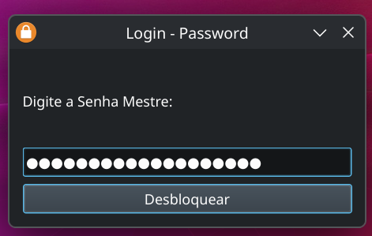
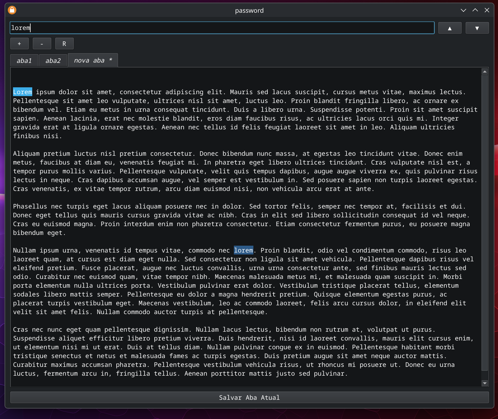

# Password Manager (PyQt6)

Uma aplicação simples e eficiente para gerenciar notas e senhas criptografadas usando GPG, desenvolvida em Python com PyQt6.





## Funcionalidades

- **Criptografia GPG:** Proteja seus dados com criptografia robusta.
- **Interface em Abas:** Gerencie múltiplos arquivos simultaneamente.
- **Editor Customizado:** Suporte a indentação inteligente (Tab/Shift+Tab).
- **Busca Rápida:** Encontre informações facilmente dentro dos seus arquivos.
- **Automação via Scripts:** Scripts prontos para iniciar e encerrar a aplicação.

## Atalhos de Teclado

| Atalho | Função |
| :--- | :--- |
| `F3` | Buscar próxima ocorrência do termo pesquisado |
| `Ctrl + S` | Salvar alterações na aba atual |
| `Ctrl + N` | Abrir diálogo para criar nova aba |
| `Ctrl + PgDown` | Mudar para a próxima aba |
| `Ctrl + PgUp` | Mudar para a aba anterior |
| `Tab` | Indentar linha ou seleção (4 espaços) |
| `Shift + Tab` | Remover indentação da linha ou seleção |
| `Enter` | Confirmar ação (Login / Criação de Cofre) |

## Pré-requisitos

- **Python 3.10+** (Geralmente pré-instalado no Linux)
  ```bash
  sudo apt install python3 python3-venv
  ```
- **GPG (GNU Privacy Guard)**
  ```bash
  sudo apt install gnupg
  ```
- **PyQt6** (Instalado via pip no ambiente virtual, veja abaixo)

## Instalação

1. Clone o repositório:
   ```bash
   git clone git@github.com:surfx/passwords_gtk.git
   cd passwords_gtk
   ```

2. Configure o ambiente automaticamente (cria venv e instala dependências):
   ```bash
   ./scripts/build.sh
   ```

## Uso

Para rodar a aplicação, utilize o script fornecido:

```bash
./scripts/run.sh
```

O script cuidará de ativar o ambiente virtual e iniciar o programa em segundo plano.

Para encerrar a aplicação:

```bash
./scripts/kill.sh
```

## Estrutura do Projeto

- `main.py`: Código principal da aplicação.
- `arquivos/`: Diretório onde os arquivos `.gpg` são armazenados.
- `scripts/`: Scripts auxiliares de execução e manutenção.
- `assets/`: Recursos visuais, como o screenshot da aplicação.

## Exemplos GPG (Referência)

```bash
# Criptografar um arquivo
gpg -c segredo.txt
gpg --batch --yes --passphrase "minhasenha123" -c segredo.txt

# Descriptografar um arquivo
gpg -d segredo.txt.gpg
gpg --batch --yes --passphrase "minhasenha123" -d segredo.txt.gpg

# Arquivos compactados (ex: 7z)
gpg --batch --yes --passphrase "minhasenha123" -c gpg.7z
gpg --batch --yes --passphrase "minhasenha123" -d gpg.7z.gpg > gpg_2.7z

# arquivo gpg simples
# criar
gpg --batch --yes --passphrase "minhasenha123" -c -o backup_senhas.json.gpg arquivo_json_original.json
# descriptografar
gpg --batch --passphrase "minhasenha123" --decrypt backup_senhas.json.gpg > meu_backup_legivel.json
```

# Urls

- [passwords_gtk](https://github.com/surfx/passwords_gtk)