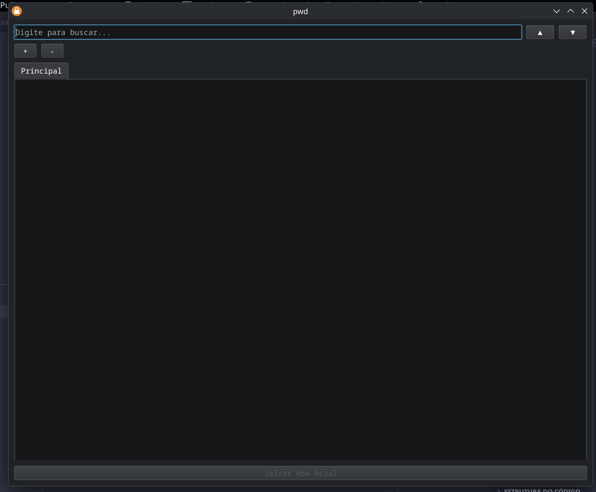

# PWD Manager (PyQt6)

Uma aplicação simples e eficiente para gerenciar notas e senhas criptografadas usando GPG, desenvolvida em Python com PyQt6.



## Funcionalidades

- **Criptografia GPG:** Proteja seus dados com criptografia robusta.
- **Interface em Abas:** Gerencie múltiplos arquivos simultaneamente.
- **Editor Customizado:** Suporte a indentação inteligente (Tab/Shift+Tab).
- **Busca Rápida:** Encontre informações facilmente dentro dos seus arquivos.
- **Automação via Scripts:** Scripts prontos para iniciar e encerrar a aplicação.

## Pré-requisitos

- Python 3.10+
- GPG instalado no sistema
- PyQt6

## Instalação

1. Clone o repositório:
   ```bash
   git clone <url-do-repositorio>
   cd passwords_gtk
   ```

2. Crie e ative um ambiente virtual:
   ```bash
   python3 -m venv venv
   source venv/bin/activate
   ```

3. Instale as dependências:
   ```bash
   pip install PyQt6
   ```

## Uso

Para rodar a aplicação, utilize o script fornecido:

```bash
./scripts/run.sh
```

O script cuidará de ativar o ambiente virtual e iniciar o programa em segundo plano.

Para encerrar a aplicação:

```bash
./scripts/kill.sh
```

## Estrutura do Projeto

- `main.py`: Código principal da aplicação.
- `arquivos/`: Diretório onde os arquivos `.gpg` são armazenados.
- `scripts/`: Scripts auxiliares de execução e manutenção.
- `assets/`: Recursos visuais, como o screenshot da aplicação.
